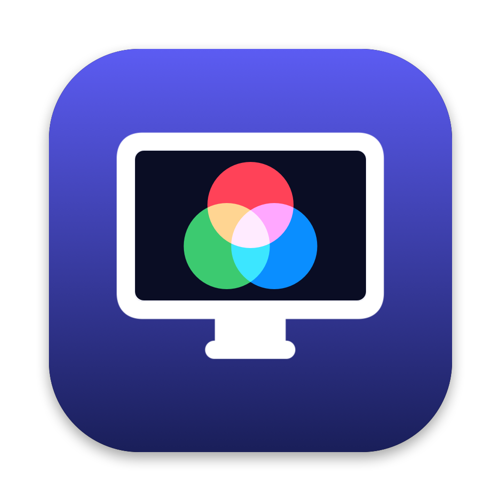

<p align="center"></p>

# RGB Lock

A small macOS menu bar app that keeps an HDMI monitor on **RGB Full** instead of the washed-out
**YCbCr Limited** mode macOS keeps switching it back to.

Apple silicon only. No dependencies, no BetterDisplay, ~350 lines of Swift.

## The problem

On Apple silicon Macs, an external monitor on HDMI is often driven as YCbCr 4:4:4 with limited
range instead of RGB. Black turns dark grey, contrast drops, text looks soft. You can force RGB
with a tool like BetterDisplay, but macOS puts YCbCr back after every display sleep or monitor
power cycle.

Watching the kernel log on wake shows what happens: macOS first restores RGB, then about 100 ms
later switches the link to YCbCr itself:

```
set_digital_out_mode: Modeset requested for colorID: 74, timingID: 46   <- RGB Full
set_digital_out_mode: Modeset requested for colorID: 77, timingID: 46   <- YCbCr 4:4:4 Limited
```

Nothing tells user space this happened: no `CGDisplayRegisterReconfigurationCallback`, no
`NSWorkspace` wake notification. So RGB Lock checks every 5 seconds and switches back when it
finds YCbCr.

## How it works

- Every 5 s it looks at each external `IOMobileFramebuffer`, reads the current color and timing
  element with `IOMobileFramebufferGetDigitalOutMode`, and finds that color element in the
  framebuffer's `ColorElements` in the IORegistry.
- If the pixel encoding is not RGB, it picks the best RGB / full range / SDR element listed in the
  current timing's `ColorModes` (same bit depth preferred) and applies it with
  `IOMobileFramebufferSetDigitalOutMode`. This is the same private call BetterDisplay uses; the
  kernel logs an identical modeset for both.
- It never switches a display that is already on RGB, and it does nothing while displays are asleep.
  Every modeset blanks the screen for a moment.
- Menu bar icon and panel show the display, the current mode (`8-bit RGB Full`), when it last fixed
  it and how many times. You can pause it, trigger a fix by hand, or toggle launch at login.

Log: `~/Library/Logs/rgb-lock.log`

## Install

Download `RGB-Lock.dmg` from [Releases](../../releases), drag the app to Applications, open it.
The first launch from `/Applications` registers it as a login item; turn that off in the panel.

The app is ad-hoc signed, not notarized. macOS blocks the first open: right-click the app,
choose **Open**, or allow it under System Settings → Privacy & Security.

## Build

Needs the Xcode command line tools (`xcode-select --install`).

```sh
./build.sh          # -> build/RGB Lock.app and build/RGB-Lock.dmg
```

The icon is drawn in code by `make-icon.swift`, so the repo has no image assets to keep in sync.

## Caveats

- **Private API.** `IOMobileFramebuffer*DigitalOutMode` is undocumented and loaded with `dlsym`.
  A macOS update can change or remove it. If it does, the panel says *Can't switch this display*
  and the app does nothing.
- **Apple silicon only.** Intel Macs use a different display stack.
- Only switches to modes the display and current timing advertise as valid. If your monitor
  offers no RGB full range mode at the current resolution and refresh rate, it leaves the
  display alone.
- Tested on a MacBook Pro M3 Max, macOS 26, with a Dell P2720DC over HDMI.

If your monitor has USB-C or DisplayPort input, a USB-C/DP cable usually gets RGB from macOS
without any of this.

## License

MIT
